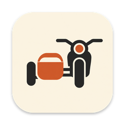

<p align="center">
  
</p>

<h1 align="center">Sidecar</h1>

<p align="center">A Mac app for customer discovery: track hypotheses and evidence, manage interview outreach, and get live coaching during calls.</p>

---

Sidecar is built for founders and researchers who do problem interviews. It keeps
the research honest by tying every hypothesis to the evidence for and against it,
counting how many independent organizations that evidence comes from, and keeping
behavior apart from opinion. During a call, it records and transcribes the
conversation and quietly suggests follow-up questions.

Everything runs locally. Projects are plain folders of JSON and Markdown that you
can read, copy, or hand to another tool.

## Features

**Research**
- Hypotheses grouped as problem, solution, and competing explanations, each with
  supporting, contradicting, and mixed evidence
- Evidence split into strong (observed behavior, specific incidents) and weak
  (opinions, capability claims, secondhand reports, your own interpretation)
- Counts of independent organizations, so two people at one company never look
  like two confirmations
- A review inbox: evidence from calls counts only after you accept it

**People and outreach**
- A contact pipeline from discovered to completed interview, with research notes,
  sources, segments, and email confidence for each person
- Organizations tracked across the project to avoid contacting coworkers by
  accident
- CSV import with column mapping and a row-by-row preview that flags duplicates,
  coworkers, and organizations you already contacted
- Drafts filled from the template in your outreach brief, then checked for dashes,
  banned phrases, length, unfilled placeholders, unverified addresses, and a second
  contact at the same organization
- A review queue where you edit and approve drafts one at a time or in bulk;
  nothing is sent without your approval

**Interview coach**
- Records the call through the Mac's microphone with the phone on speakerphone
- Live transcription with speaker labels, and short coaching cards from Claude:
  follow-ups worth asking, leading questions, counterevidence, and when to keep
  listening
- `MARK` for a deeper look at the last minute and a half, `ASK NEXT` for the single
  best next question
- A clean transcript after the call, and audio that is always saved even if the
  network or an API fails

**Your data**
- Each project is a folder of readable files with a README describing them
- One-click export to a single JSON file and a Markdown digest
- A daily backup of every project, kept for 14 days in
  `~/Library/Application Support/Sidecar/backups/`

## Status

Sidecar is early. Working today: projects, hypotheses, evidence review, people,
organizations, CSV import, drafting and approving emails, interview scheduling notes,
briefs, export, backups, and calls with the interview coach inside the app. In
progress: sending approved email through Gmail, and prospect research. Until Gmail is
connected, approved emails wait in the queue. The full plan is in [docs/spec.md](docs/spec.md).

## Requirements

- macOS 13 or later
- [uv](https://docs.astral.sh/uv/), which installs Python 3.14 for the project
- Node.js 24 or later
- Rust 1.90 or later and the Xcode command line tools
- An [Anthropic](https://console.anthropic.com/) API key and a
  [Deepgram](https://console.deepgram.com/) API key for the interview coach

## Getting started

```sh
git clone <this repository> sidecar && cd sidecar
uv sync
mkdir -p ~/.config/sidecar
cp .env.example ~/.config/sidecar/.env         # add your API keys
cp config.example.toml ~/.config/sidecar/config.toml
uv run sidecar seed             # create the example project
cd app && npm install && npm run tauri dev
```

The first build compiles the Rust shell, which takes a few minutes. After that the
app opens in a few seconds. It starts its Python engine on a random local port and
stops it when you quit.

`uv run sidecar seed` creates an example project from the fictional study in
`examples/`, about how small bakeries decide what to bake. To start your own study,
write a research brief and, if you plan to email people, an outreach brief. Both
are Markdown files read by their headings; the examples show every section, and
`src/sidecar/briefs.py` lists them. Then:

```sh
uv run sidecar new "My study" --brief path/to/brief.md [--outreach path/to/outreach.md]
```

## Running an interview

In the app, open a person and choose **Start call**, or use **New call** on the
Calls page. Sidecar runs the coach's checks, opens the call window, and starts
recording when you press Start there. When the call ends, the session is saved in
the project's `calls/` folder and its evidence goes to the Inbox for review. The
app will not quit while a call is running.

The coach also runs from the terminal:

```sh
uv run coach preflight
uv run coach run --interviewee "Name" --org "Company" --minutes 30
```

Preflight checks the microphone, both API keys, disk space, and the local port.
`run` opens the coaching page in your browser; press Enter to start recording.
The keys during a call are `M` (mark), `Q` (ask next), `S` (swap speaker labels),
and `Esc` (dismiss). See [docs/coach.md](docs/coach.md) for the full guide,
including the pre-call checklist and how speaker labels work.

Afterward, add the call and its evidence to a project. The evidence lands in the
Inbox for review:

```sh
uv run sidecar import-call <project> ~/Documents/Sidecar/recordings/<session>
```

## Configuration

| File | Purpose |
|---|---|
| `~/.config/sidecar/.env` | API keys. |
| `~/.config/sidecar/config.toml` | Coach settings: microphone, Deepgram options and keyterms, models, the brief and prompts to use, where recordings go, your transcript label, coaching activity level, prices. Start from `config.example.toml`. |
| `examples/` | A fictional research brief and outreach brief to start from. |
| `prompts/` | The coach's system prompt and per-mode instructions. |

API keys, settings, briefs, and recordings all live outside the repository, so
nothing personal can be committed by accident. Point `brief_path` and `prompts_dir`
in your config at your own brief and any prompts you customize (your project folder
is a good place). `SIDECAR_CONFIG_DIR` overrides the config directory. Use `uv run coach --config other.toml ...` for a second study.

## Data and privacy

Projects live in `~/Documents/Sidecar/<project>/`. Each file is plain JSON or
Markdown, and the previous version of every file is kept in a hidden `.sidecar/`
folder. Recordings and transcripts from the coach are saved in
`~/Documents/Sidecar/recordings/` by default.

Nothing is sent anywhere except what each feature needs: call audio goes to
Deepgram for transcription, and transcripts plus your brief go to Anthropic for
coaching. There are no accounts, analytics, or telemetry.

To export a project:

```sh
uv run sidecar export <project>
```

## Development

```sh
git config core.hooksPath .githooks             # block secrets and recordings in commits
uv run pytest                                   # Python tests
uv run ruff check . && uv run ruff format --check .
cd app && npm run check && npm run lint         # svelte-check, ESLint, Prettier
cd app/src-tauri && cargo clippy -- -D warnings
```

```
app/              desktop app: Svelte UI in app/src, Tauri shell in app/src-tauri
src/sidecar/      engine: project store, local HTTP API, seeding, export
src/coach/        interview coach
prompts/          coach prompts
examples/         example research and outreach briefs
docs/             design spec and coach guide
tests/            Python tests
```

[app/README.md](app/README.md) covers working on the UI in a browser.

## License

Sidecar is licensed under the [Apache License 2.0](LICENSE).
